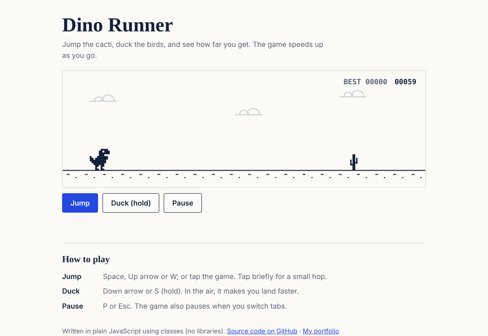

# Dino Runner

An endless-runner game written in plain JavaScript with classes and no libraries. Jump the cacti, duck the birds; the game speeds up the longer you survive.

**Play it:** https://daivik-b.github.io/dino-runner/



## Why I made it

My first programming was a WhiteHat Jr. course in 2021–22, where I made browser games like a dinosaur runner, Pac-Man and a Super Mario-style platformer using objects. This is that idea rebuilt properly: organised into classes, tested, and published.

The dinosaur, cacti and birds are my own simple pixel drawings, made from rows of text in the code.

## How to play

| Action | Keyboard | Touch |
|---|---|---|
| Start / jump | Space, Up arrow or W (tap briefly for a small hop) | Tap the game, or the **Jump** button |
| Duck | Down arrow or S (hold); in the air it makes you land faster | Hold the **Duck** button |
| Pause | P or Esc (also pauses when you switch tabs) | **Pause** button |

Birds appear after 300 points, at three heights: jump the low ones, duck the middle ones, run under the high ones.

## Run it yourself

No build step. Clone the repository and open `index.html` in a browser.

Run the tests (needs [Node.js](https://nodejs.org/) 18 or newer; nothing to install):

```bash
npm test
```

## How the code is organised

```
index.html        the page: canvas, buttons, instructions
css/style.css     page styles
js/engine.js      the game itself: all classes and rules, no page code
js/main.js        connects the game to the page: keyboard, touch, the animation loop
tests/            16 automated tests for the rules in engine.js
```

The classes in `engine.js`:

```
Entity            position + size; collision detection
├── Dino          jumps, ducks, falls with gravity
├── Obstacle      scrolls towards the player
│   ├── Cactus    1-3 stems; jump over
│   └── Bird      three heights; flies slightly faster than the ground
└── Cloud         background, moves slowly (parallax)
Spawner           decides when the next obstacle comes, and which kind
Game              state (ready / running / paused / over), score, speed, collisions
```

**Inheritance in practice:** `Cactus` and `Bird` both extend `Obstacle`, which extends `Entity`. Collision detection is written once, in `Entity.intersects()`, and every object gets it for free. `Bird` overrides `update()` to fly faster, then calls `super.update()` so it doesn't repeat the movement code.

## Design decisions

1. **Rules separate from the page.** `engine.js` has no DOM code, so the same file runs in the browser and in Node for testing.
2. **Fixed time step.** Physics runs at exactly 120 steps per second, however fast the screen refreshes, so the game plays the same on a 60 Hz laptop and a 120 Hz phone.
3. **Fair collisions.** Hit boxes are a few pixels smaller than the drawings, so a near-miss that *looks* like a miss *is* a miss.
4. **Gaps grow with speed.** Obstacles are spaced by `0.75 × speed + 140` pixels or more, so a jump can always clear them in time.
5. **Seeded randomness.** The random generator can be given a seed, so tests are repeatable.
6. **Readable on phones.** On a narrow screen the whole game is shrunk to fit, so the score and messages are drawn larger there. This was added after checking the game at phone width, where the text had become unreadable.

## How it was tested

- **16 automated tests** (`npm test`): collisions, jump height and landing, no double jumps, short hops, ducking, which move each bird height needs, obstacle spacing, when birds appear, scoring, the speed cap, crashing, the restart delay and pausing.
- **An autopilot check:** a simple script played 40 three-minute games with different seeds, up to top speed, facing 5,157 obstacles without crashing. That shows the spacing rules never create an impossible gap.
- **In a real browser** (Chromium) at desktop and phone width: no errors, no horizontal scrolling, and Space does not scroll the page.

## Limitations and ideas

- No sound, and no night mode yet.
- The best score is saved only in your own browser (`localStorage`).
- Ideas: a difficulty setting, sound effects, and an online leaderboard.

## Built with

HTML, CSS and JavaScript, tested with Node's built-in test runner, and hosted on GitHub Pages. Built with help from an AI coding assistant (Claude). I reviewed the code and checked that the game plays correctly.

## Licence

MIT. See [LICENSE](LICENSE).
